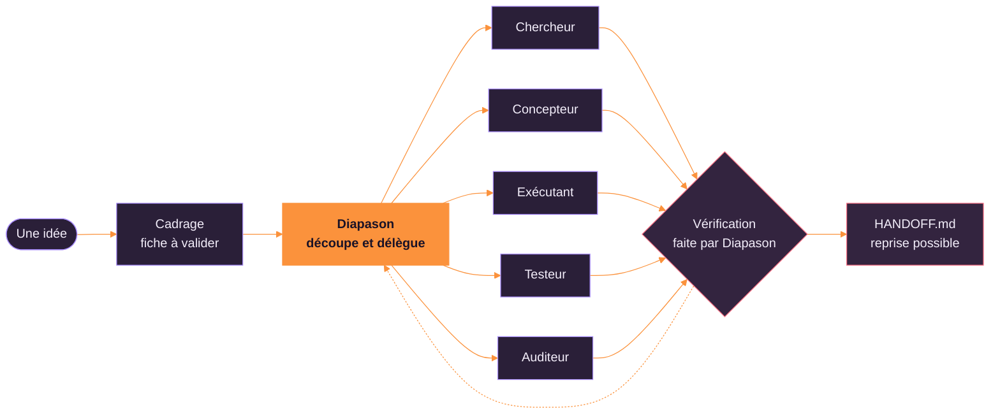

<picture>
  <source media="(prefers-color-scheme: dark)" srcset="assets/header-dark.svg">
  
</picture>

  

  
  
  

## 🧑‍💻 À propos

  <picture>
    <source media="(prefers-color-scheme: dark)" srcset="assets/about-dark.svg">
    
  </picture>

## 🤖 Mon virage IA

| | |
|---|---|
| 🧠 **Mon premier projet d'agents** | [`Diapason`](https://github.com/MalikMoussaoui/diapason) (version 1.7) : un skill Claude Code qui cadre le projet avec toi, confie le travail à des sous-agents, vérifie lui-même les faits décisifs et laisse une passation reprenable |
| 📡 **IA en direct** | En cours : des IA qui apprennent seules à conduire et à faire la course sur un circuit 2D (apprentissage par renforcement), avec une page web pour suivre leurs progrès en quasi-direct. Le dépôt arrive bientôt |

Comment fonctionne Diapason, en une image :

## 🛠️ Stack

<b>IA</b> 
  
  
  

<b>LANGAGES</b> 
  <picture>
    <source media="(prefers-color-scheme: dark)" srcset="https://skillicons.dev/icons?i=typescript%2Cjavascript%2Clua%2Cpython%2Cjava%2Ckotlin%2Cdart%2Cswift%2Ccs%2Cbash&theme=dark">
    
  </picture>

<b>FRONT</b> 
  <picture>
    <source media="(prefers-color-scheme: dark)" srcset="https://skillicons.dev/icons?i=react%2Cnextjs%2Cvuejs%2Castro%2Ctailwindcss%2Cthreejs%2Cvite%2Cflutter%2Chtml%2Ccss&theme=dark">
    
  </picture>

<b>BACK</b> 
  <picture>
    <source media="(prefers-color-scheme: dark)" srcset="https://skillicons.dev/icons?i=nodejs%2Cdiscordjs%2Cprisma%2Cmongodb%2Cpostgresql%2Csqlite%2Cspring%2Cdocker%2Cnginx&theme=dark">
    
  </picture>

<b>JEUX &amp; OUTILS</b> 
  <picture>
    <source media="(prefers-color-scheme: dark)" srcset="https://skillicons.dev/icons?i=robloxstudio%2Cgit%2Cgithub%2Cgithubactions%2Cvscode%2Cpnpm&theme=dark">
    
  </picture> 
  

## 📊 En chiffres

  <picture>
    <source media="(prefers-color-scheme: dark)" srcset="assets/stats-dark.svg">
    
  </picture>
  <picture>
    <source media="(prefers-color-scheme: dark)" srcset="assets/langs-dark.svg">
    
  </picture>

Dépôts publics et privés · mis à jour chaque jour par GitHub Actions

## 🚀 Projets à la une

  <a href="https://github.com/MalikMoussaoui/diapason"><picture>
    <source media="(prefers-color-scheme: dark)" srcset="assets/repo-diapason-dark.svg">
    
  </picture></a>
  <a href="https://github.com/MalikMoussaoui/lyra-lyrics"><picture>
    <source media="(prefers-color-scheme: dark)" srcset="assets/repo-lyra-lyrics-dark.svg">
    
  </picture></a>

🎵 <b>Lyra Lyrics</b> : une app Mac en Swift (version 1.0.1) qui affiche les paroles synchronisées de ce que tu écoutes sur Spotify ou Apple Music.

### 🔒 En coulisses (dépôts privés)

| | |
|---|---|
| 🚓 **FiveM / GTA RP** | Scripts Lua sur mesure (customs, recoil, médias) et outils pour serveurs RP |
| 🧱 **Roblox** | Jeux en Luau, en solo et en équipe |
| 🤖 **Bots Discord & SaaS** | Next.js, Fastify, Stripe, MongoDB, Socket.io |
| 📱 **Mobile** | Flutter, Kotlin, Swift |

## 🐍 Mes contributions, version snake

<picture>
  <source media="(prefers-color-scheme: dark)" srcset="https://raw.githubusercontent.com/MalikMoussaoui/MalikMoussaoui/output/snake-dark.svg">
  
</picture>

## 📫 Me trouver

  
  

