<picture>
  <source media="(prefers-color-scheme: dark)" srcset="assets/header-dark.svg">
  
</picture>

## À propos

  <picture>
    <source media="(prefers-color-scheme: dark)" srcset="assets/about-dark.svg">
    
  </picture>

## Projets

<!-- PROJETS:DEBUT -->

  <a href="https://github.com/MalikChopa/lullaby-lake"><picture><source media="(prefers-color-scheme: dark)" srcset="assets/projets/lullaby-lake-dark.svg"></picture></a>
  <a href="https://github.com/MalikChopa/prismaze"><picture><source media="(prefers-color-scheme: dark)" srcset="assets/projets/prismaze-dark.svg"></picture></a>
  <a href="https://github.com/MalikChopa/gloam"><picture><source media="(prefers-color-scheme: dark)" srcset="assets/projets/gloam-dark.svg"></picture></a>
  <a href="https://github.com/MalikChopa/sumi-niwa"><picture><source media="(prefers-color-scheme: dark)" srcset="assets/projets/sumi-niwa-dark.svg"></picture></a>
  <a href="https://github.com/MalikChopa/huezz"><picture><source media="(prefers-color-scheme: dark)" srcset="assets/projets/huezz-dark.svg"></picture></a>
  <a href="https://github.com/MalikChopa/diapason"><picture><source media="(prefers-color-scheme: dark)" srcset="assets/projets/diapason-dark.svg"></picture></a>
  <a href="https://github.com/MalikChopa/lyra-lyrics"><picture><source media="(prefers-color-scheme: dark)" srcset="assets/projets/lyra-lyrics-dark.svg"></picture></a>
  <picture><source media="(prefers-color-scheme: dark)" srcset="assets/projets/kashmo-dark.svg"></picture>

<b>À essayer :</b> <a href="https://malikchopa.github.io/lullaby-lake/">lullaby-lake</a> · <a href="https://malikchopa.github.io/prismaze/">prismaze</a> · <a href="https://malikchopa.github.io/gloam/">gloam</a> · <a href="https://MalikChopa.github.io/sumi-niwa/">sumi-niwa</a> · <a href="https://malikchopa.github.io/huezz/">huezz</a>

<!-- PROJETS:FIN -->

Comment fonctionne Diapason

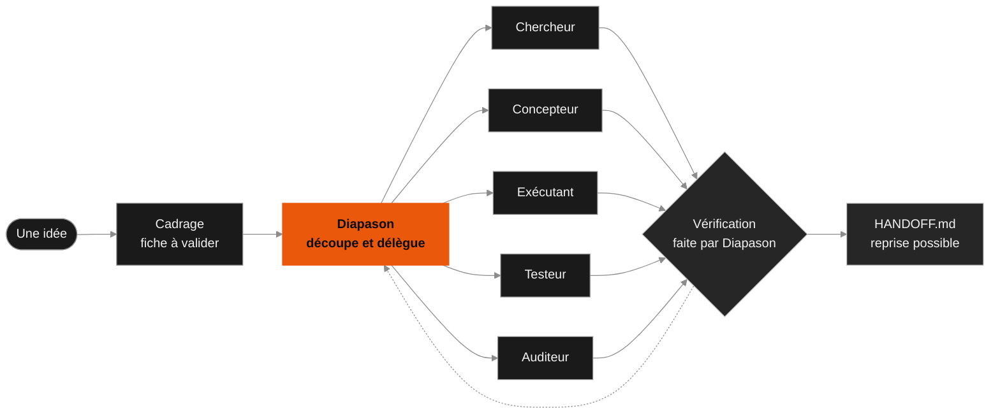

<!-- sol-0:start -->
## Sol-0

Un rover simulé qui apprend seul à exister sur une planète procédurale.

A simulated rover that learns on its own to exist on a procedural planet.

Watch the trailer · Voir la bande-annonce (39 s)

[▶ Voir en direct · Watch live](https://sol0.fr/)

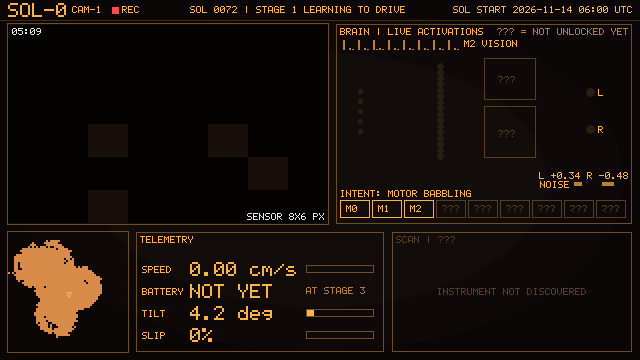

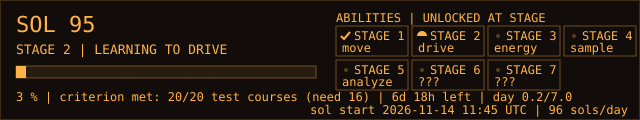

<a href="https://raw.githubusercontent.com/MalikChopa/MalikChopa/state/map.png">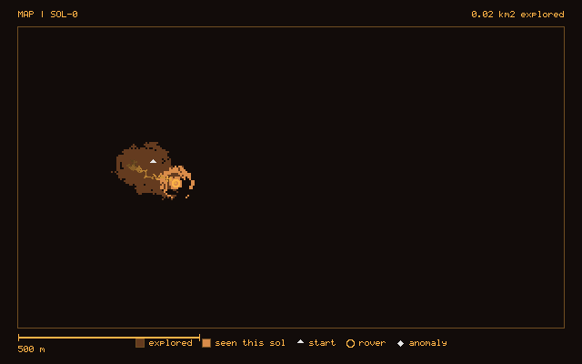</a>

[Journal](journal/README.md) · [Atlas](atlas/README.md) · [Premières fois / Firsts](firsts/README.md) · [Comment ça marche](pages/how-it-works.fr.md) · [How it works](pages/how-it-works.en.md)

Sol-0 vit en continu sur un serveur, un sol toutes les 15 minutes ; ces images rejouent un sol récent (de moins de 6 heures). Tout ce qui est affiché vient du calcul réel.

Sol-0 lives continuously on a server, one sol every 15 minutes; these images replay a recent sol (less than 6 hours old). Everything shown comes from the actual computation.
<!-- sol-0:end -->

## Stack

| | |
|---|---|
| **Le plus utilisé** | TypeScript · JavaScript · Node.js · React · Next.js · Tailwind CSS · Vite · Fastify · Lua (FiveM) · Luau (Roblox) · Claude Code |
| **Aussi pratiqué** | Swift · Python · Three.js · WebGL · WebGPU · Vue · Astro · discord.js · Prisma · MongoDB · SQLite · Git · GitHub Actions |
| **Vu en cours ou en petit projet** | Java · Spring · PostgreSQL · Docker · Kotlin · Dart et Flutter · C# |

Classé d'après ce que contiennent mes dépôts, publics et privés.

## En chiffres

  <picture>
    <source media="(prefers-color-scheme: dark)" srcset="assets/stats-dark.svg">
    
  </picture>

  <picture>
    <source media="(prefers-color-scheme: dark)" srcset="assets/langs-dark.svg">
    
  </picture>

Commits et contributions : tous dépôts, privés compris · versions, étoiles et langages : dépôts publics seulement · mis à jour chaque jour par GitHub Actions

## En coulisses (dépôts privés)

| | |
|---|---|
| FiveM / GTA RP | Scripts Lua sur mesure (customs, recoil, médias) et outils pour serveurs RP |
| Roblox | Jeux en Luau, en solo et en équipe |
| Bots Discord et SaaS | Next.js, Fastify, Stripe, MongoDB, Socket.io |
| Mobile | Flutter, Kotlin |

## Contributions

<picture>
  <source media="(prefers-color-scheme: dark)" srcset="https://raw.githubusercontent.com/MalikChopa/MalikChopa/output/snake-dark.svg">
  
</picture>

## Contact

  

