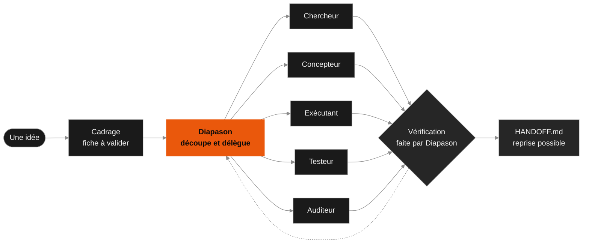

<picture>
  <source media="(prefers-color-scheme: dark)" srcset="assets/header-dark.svg">
  
</picture>

## À propos

  <picture>
    <source media="(prefers-color-scheme: dark)" srcset="assets/about-dark.svg">
    
  </picture>

## Projets

**[Diapason](https://github.com/MalikChopa/diapason)** · Shell · MIT ·  
Skill Claude Code : il cadre le projet avec toi, confie le travail à des sous-agents, vérifie lui-même les faits décisifs et laisse une passation reprenable.

**[Lyra Lyrics](https://github.com/MalikChopa/lyra-lyrics)** · Swift · MIT ·  
App macOS : une petite fenêtre toujours au premier plan qui affiche les paroles synchronisées de Spotify ou d'Apple Music.

**Kashmo** · TypeScript · dépôt privé 
Plateforme Discord complète : bot, tableau de bord multi-serveur et jeu de cartes pour animer une communauté.

**IA en direct** · Python · dépôt à venir 
Une IA apprend seule à conduire une voiture sur un circuit 2D, avec une page web pour suivre ses progrès en quasi-direct.

Comment fonctionne Diapason

## Stack

| | |
|---|---|
| **IA** | Claude Code · Diapason · Stable-Baselines3 |
| **Langages** | TypeScript · JavaScript · Lua · Luau · Python · Java · Kotlin · Dart · Swift · C# · Bash |
| **Front** | React · Next.js · Vue · Astro · Tailwind CSS · Three.js · Vite · Flutter |
| **Back** | Node.js · discord.js · Fastify · Prisma · MongoDB · PostgreSQL · SQLite · Spring · Docker · Nginx |
| **Jeux et outils** | FiveM · Roblox Studio · Git · GitHub Actions · VS Code · pnpm |

## En chiffres

  <picture>
    <source media="(prefers-color-scheme: dark)" srcset="assets/stats-dark.svg">
    
  </picture>

  <picture>
    <source media="(prefers-color-scheme: dark)" srcset="assets/langs-dark.svg">
    
  </picture>

Commits et contributions : tous dépôts, privés compris · versions, étoiles et langages : dépôts publics seulement · mis à jour chaque jour par GitHub Actions

## En coulisses (dépôts privés)

| | |
|---|---|
| FiveM / GTA RP | Scripts Lua sur mesure (customs, recoil, médias) et outils pour serveurs RP |
| Roblox | Jeux en Luau, en solo et en équipe |
| Bots Discord et SaaS | Next.js, Fastify, Stripe, MongoDB, Socket.io |
| Mobile | Flutter, Kotlin, Swift |

## Contributions

<picture>
  <source media="(prefers-color-scheme: dark)" srcset="https://raw.githubusercontent.com/MalikChopa/MalikChopa/output/snake-dark.svg">
  
</picture>

## Contact

  
  

