<picture>
  <source media="(prefers-color-scheme: dark)" srcset="assets/header-dark.svg">
  
</picture>

## À propos

  <picture>
    <source media="(prefers-color-scheme: dark)" srcset="assets/about-dark.svg">
    
  </picture>

## Projets

  <a href="https://github.com/MalikChopa/diapason"><picture>
    <source media="(prefers-color-scheme: dark)" srcset="assets/repo-diapason-dark.svg">
    
  </picture></a>
  <a href="https://github.com/MalikChopa/lyra-lyrics"><picture>
    <source media="(prefers-color-scheme: dark)" srcset="assets/repo-lyra-lyrics-dark.svg">
    
  </picture></a>
  <picture>
    <source media="(prefers-color-scheme: dark)" srcset="assets/repo-kashmo-dark.svg">
    
  </picture>
  <picture>
    <source media="(prefers-color-scheme: dark)" srcset="assets/repo-ia-en-direct-dark.svg">
    
  </picture>

Diapason (version 1.7) et Lyra Lyrics (version 1.0.1) sont publics. Kashmo est un dépôt privé, IA en direct n'est pas encore publiée.

Comment fonctionne Diapason

## Stack

  <picture>
    <source media="(prefers-color-scheme: dark)" srcset="assets/stack-dark.svg">
    
  </picture>

## En chiffres

  <picture>
    <source media="(prefers-color-scheme: dark)" srcset="assets/stats-dark.svg">
    
  </picture>
  <picture>
    <source media="(prefers-color-scheme: dark)" srcset="assets/langs-dark.svg">
    
  </picture>

Dépôts publics et privés · mis à jour chaque jour par GitHub Actions

## En coulisses (dépôts privés)

| | |
|---|---|
| FiveM / GTA RP | Scripts Lua sur mesure (customs, recoil, médias) et outils pour serveurs RP |
| Roblox | Jeux en Luau, en solo et en équipe |
| Bots Discord et SaaS | Next.js, Fastify, Stripe, MongoDB, Socket.io |
| Mobile | Flutter, Kotlin, Swift |

## Contributions

<picture>
  <source media="(prefers-color-scheme: dark)" srcset="https://raw.githubusercontent.com/MalikChopa/MalikChopa/output/snake-dark.svg">
  
</picture>

## Contact

  
  

