<picture>
  <source media="(prefers-color-scheme: dark)" srcset="assets/header-dark.svg">
  
</picture>

## À propos

  <picture>
    <source media="(prefers-color-scheme: dark)" srcset="assets/about-dark.svg">
    
  </picture>

## Projets

<!-- PROJETS:DEBUT -->

  <a href="https://github.com/MalikChopa/huezz"><picture><source media="(prefers-color-scheme: dark)" srcset="assets/projets/huezz-dark.svg"></picture></a>
  <a href="https://github.com/MalikChopa/sumi-niwa"><picture><source media="(prefers-color-scheme: dark)" srcset="assets/projets/sumi-niwa-dark.svg"></picture></a>
  <a href="https://github.com/MalikChopa/diapason"><picture><source media="(prefers-color-scheme: dark)" srcset="assets/projets/diapason-dark.svg"></picture></a>
  <a href="https://github.com/MalikChopa/lyra-lyrics"><picture><source media="(prefers-color-scheme: dark)" srcset="assets/projets/lyra-lyrics-dark.svg"></picture></a>
  <a href="https://github.com/MalikChopa/Valorant_Chaos_Overlay"><picture><source media="(prefers-color-scheme: dark)" srcset="assets/projets/valorant-chaos-overlay-dark.svg"></picture></a>
  <picture><source media="(prefers-color-scheme: dark)" srcset="assets/projets/kashmo-dark.svg"></picture>
  <picture><source media="(prefers-color-scheme: dark)" srcset="assets/projets/ia-en-direct-dark.svg"></picture>

<!-- PROJETS:FIN -->

Comment fonctionne Diapason

## Stack

| | |
|---|---|
| **IA** | Claude Code · Diapason · Stable-Baselines3 |
| **Langages** | TypeScript · JavaScript · Lua · Luau · Python · Java · Kotlin · Dart · Swift · C# · Bash |
| **Front** | React · Next.js · Vue · Astro · Tailwind CSS · Three.js · Vite · Flutter |
| **Back** | Node.js · discord.js · Fastify · Prisma · MongoDB · PostgreSQL · SQLite · Spring · Docker · Nginx |
| **Jeux et outils** | FiveM · Roblox Studio · Git · GitHub Actions · VS Code · pnpm |

## En chiffres

  <picture>
    <source media="(prefers-color-scheme: dark)" srcset="assets/stats-dark.svg">
    
  </picture>

  <picture>
    <source media="(prefers-color-scheme: dark)" srcset="assets/langs-dark.svg">
    
  </picture>

Commits et contributions : tous dépôts, privés compris · versions, étoiles et langages : dépôts publics seulement · mis à jour chaque jour par GitHub Actions

## En coulisses (dépôts privés)

| | |
|---|---|
| FiveM / GTA RP | Scripts Lua sur mesure (customs, recoil, médias) et outils pour serveurs RP |
| Roblox | Jeux en Luau, en solo et en équipe |
| Bots Discord et SaaS | Next.js, Fastify, Stripe, MongoDB, Socket.io |
| Mobile | Flutter, Kotlin, Swift |

## Contributions

<picture>
  <source media="(prefers-color-scheme: dark)" srcset="https://raw.githubusercontent.com/MalikChopa/MalikChopa/output/snake-dark.svg">
  
</picture>

## Contact

  

